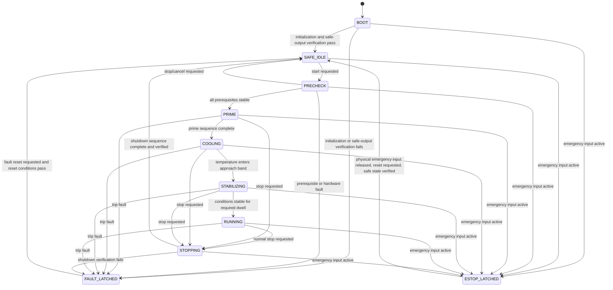

# Chamber Safety Supervisor and State Machine

Status: design proposal for the post-0.2.11 firmware architecture  
Baseline used: firmware 0.2.11; CLI framing/banner correction prepared as 0.2.12

## 1. Purpose

The chamber supervisor is the single authority that decides whether hazardous or process outputs may operate. It sits above the existing module drivers and chamber subsystems.

The existing drivers remain responsible for safe device-level operations such as forcing an enable line low before changing a DAC. The supervisor is responsible for system-level decisions such as whether cooling, pumps, heaters, fans, and high voltage may be active together.

The first implementation should favour predictable shutdown and observable faults over automatic recovery.

## 2. Architectural rule: one actuator owner

Once the supervisor is enabled, only it may command chamber actuators during normal operation.

```text
TCP CLI / HTTP
      |
      v
command queue  --->  chamber supervisor  --->  subsystem APIs  --->  module drivers
                           ^
                           |
                    sensing snapshot
```

CLI and HTTP callbacks must not directly perform long or hazardous hardware operations. They should validate and enqueue a request, then return. The main loop consumes requests and executes them through the supervisor.

This is important because the current CLI and HTTP handlers run in the CYW43/lwIP callback context and directly call subsystem and module functions. That is acceptable for the present hardware-test firmware, but it must not remain the normal control path for an automatic chamber.

### Service mode

Low-level hardware-test commands should remain available, but only in an explicit service mode with these rules:

- Service mode can be entered only from `SAFE_IDLE` with no active faults.
- Entering service mode first applies and verifies the safe output state.
- Automatic start is prohibited while service mode is active.
- Leaving service mode applies and verifies the safe state again.
- Hazardous commands, especially HV, should ultimately require a physical interlock or local enable in addition to a network command.
- At minimum, direct actuator commands must be rejected whenever the supervisor is starting, running, stopping, faulted, or emergency-stopped.

## 3. Proposed chamber states



### State meanings

| State | Meaning | Outputs permitted |
|---|---|---|
| `BOOT` | Firmware and hardware initialization; force safe state before trusting software state | No hazardous outputs |
| `SAFE_IDLE` | Chamber is stopped, safe outputs are verified, commands may be accepted | Non-hazardous status/diagnostics only |
| `PRECHECK` | Validate modules, sensors, interlocks, communication, and output feedback for a stable dwell | No hazardous outputs |
| `PRIME` | Controlled IPA circulation/wick preparation sequence | Approved pumps only |
| `COOLING` | Ramp TEC demand while circulation and cooling protections are active | Pumps, fans, TECs; no HV |
| `STABILIZING` | Hold target conditions for a configured dwell | Pumps, fans, TECs; normally no HV |
| `RUNNING` | Normal chamber operation | Only outputs explicitly allowed by the run policy |
| `STOPPING` | Ordered shutdown with verification and optional drain/post-run ventilation | Reduced output set according to shutdown policy |
| `FAULT_LATCHED` | A trip occurred; safe action applied; operator reset required | Only outputs explicitly designated safe during a fault |
| `ESTOP_LATCHED` | Highest-priority trip; physical release and operator reset required | Hard safe state |

`PRIME`, `COOLING`, `STABILIZING`, and the exact `STOPPING` sequence are process-policy states. Their actions and durations should remain configuration data until the physical chamber sequence is agreed and tested.

## 4. Safe-state action

Create one reusable function, separate from the CLI command, that applies the system safe state and returns a detailed result.

Recommended order:

1. Force the HV enable low, then verify the enable feedback is low.
2. Force all TEC enables low, then place all TEC DACs in shutdown.
3. Set hazardous low-side PWM outputs to zero.
4. Stop pumps, cancel timed pump operations, and place unused/required stepper outputs in hard HiZ.
5. Apply the configured fan policy.
6. Disable AD7124 excitation currents.
7. Read back every available authoritative enable/status signal.

The existing root `safe` command already performs most of these operations. Its implementation should be moved into a reusable `chamber_apply_safe_state()` function so the boot path, supervisor, fault handler, service-mode transitions, CLI command, and watchdog-recovery path all use the same code.

A safe-state request is not considered successful merely because commands were sent. Authoritative enable lines and available feedback must confirm the result.

### Fan policy is a required design decision

The current `safe` command stops all PWM loads and all fan PWM outputs. For a faulted IPA chamber, some fans may need to continue for ventilation or electronics cooling, while others may need to stop. The PWM/fan channel assignment and electrical safety analysis must define one of these policies for each fan:

- always stop;
- continue during controlled shutdown only;
- continue during a fault if power and tach feedback remain healthy;
- powered independently of the supervisor.

Until that mapping is approved, the conservative firmware default should remain all fan outputs off.

## 5. Input snapshot and freshness

The supervisor should consume one immutable snapshot per evaluation cycle rather than reading devices ad hoc throughout transition logic.

```c
typedef struct {
    uint32_t captured_ms;

    bool emergency_input_valid;
    bool emergency_active;
    bool lid_interlock_valid;
    bool lid_closed;

    bool adc_valid;
    uint32_t adc_age_ms;
    double rtd_c[ZTM_ADC_RTD_COUNT];
    bool rtd_valid[ZTM_ADC_RTD_COUNT];
    double tc_mv[ZTM_ADC_TC_COUNT];
    bool tc_valid[ZTM_ADC_TC_COUNT];

    cooling_tec_status_t tec[COOLING_TEC_COUNT];
    bool cooling_feedback_valid;

    ztm_psu_hv_snapshot_t hv;
    bool hv_snapshot_valid;

    pumping_status_t pumping;

    bool fan_rpm_valid[ZTM_PWM_FAN_COUNT];
    uint32_t fan_rpm[ZTM_PWM_FAN_COUNT];
    bool load_current_valid[ZTM_PWM_CHANNEL_COUNT];
    int32_t load_current_uA[ZTM_PWM_CHANNEL_COUNT];

    bool stepper_fault_active;
    bool pwm_irq_fault_active;
} chamber_inputs_t;
```

Each measurement must carry a validity flag and age. A plausible old value is not a valid current value. Every interlock should define a maximum age; exceeding it becomes a sensor-stale fault.

The AD7124 measurements are blocking one-shot conversions today. The sensing layer should therefore schedule channels deliberately and cache results. Safety-critical channels get higher priority and shorter stale limits than informational channels.

## 6. Fault model

Use a 64-bit active-fault mask and a separate latched-fault mask. Store the first trip cause, timestamp, state, and snapshot summary so later secondary faults do not hide the initiating event.

```c
typedef uint64_t chamber_fault_mask_t;

typedef enum {
    CHAMBER_FAULT_NONE                    = 0,
    CHAMBER_FAULT_ESTOP_ACTIVE            = 1ull << 0,
    CHAMBER_FAULT_LID_OPEN                = 1ull << 1,
    CHAMBER_FAULT_REQUIRED_MODULE         = 1ull << 2,
    CHAMBER_FAULT_SENSOR_INVALID          = 1ull << 3,
    CHAMBER_FAULT_SENSOR_STALE            = 1ull << 4,
    CHAMBER_FAULT_TEMPERATURE_LIMIT       = 1ull << 5,
    CHAMBER_FAULT_COOLANT_FLOW            = 1ull << 6,
    CHAMBER_FAULT_TEC_FEEDBACK            = 1ull << 7,
    CHAMBER_FAULT_FAN_STALL               = 1ull << 8,
    CHAMBER_FAULT_STEPPER_STALL           = 1ull << 9,
    CHAMBER_FAULT_STEPPER_OVERTEMP        = 1ull << 10,
    CHAMBER_FAULT_HV_PGOOD                = 1ull << 11,
    CHAMBER_FAULT_HV_FEEDBACK             = 1ull << 12,
    CHAMBER_FAULT_HV_INPUT_OVERVOLTAGE    = 1ull << 13,
    CHAMBER_FAULT_OUTPUT_WILL_NOT_DISABLE = 1ull << 14,
    CHAMBER_FAULT_CONTROL_LOOP_STALLED    = 1ull << 15,
} chamber_fault_bit_t;
```

### Severity classes

| Class | Response | Reset behaviour |
|---|---|---|
| Advisory | Log and expose status; no state change | Clears automatically |
| Warning | Continue temporarily or derate; start a persistence timer | Clears after healthy dwell |
| Controlled stop | Enter `STOPPING` and preserve the first cause | Operator acknowledgement normally required |
| Immediate trip | Apply safe state immediately and enter `FAULT_LATCHED` | Operator reset required |
| Emergency stop | Apply hard safe state and enter `ESTOP_LATCHED` | Physical release plus operator reset required |

Faults should use assertion and clearing dwell times. For example, a fan tach may need several seconds after startup before low RPM is considered a stall, while an HV input-overvoltage indication should trip on the first valid observation.

## 7. State-transition rules

### `BOOT` to `SAFE_IDLE`

Required:

- base hardware initialization completed;
- safe-state action was issued;
- HV enable readback confirms off;
- every fitted TEC enable confirms off where readable;
- all commanded PWM loads are zero;
- pump state is off and timed actions are cancelled;
- no emergency input is active.

A missing optional module can be recorded as unavailable. A missing module required by the configured chamber profile prevents automatic start but should not prevent the diagnostic console from operating.

### `SAFE_IDLE` to `PRECHECK`

Required:

- start request received through the supervisor command queue;
- service mode inactive;
- no latched fault;
- safe state currently verified;
- configured required modules initialized;
- start interlocks valid.

### `PRECHECK` to `PRIME`

All required conditions must be valid continuously for a configurable dwell, initially proposed as 2 seconds:

- emergency input inactive;
- lid/cover interlock closed if fitted;
- safety-critical sensors valid and fresh;
- plate, coolant, hot-side, electronics, and ambient temperatures within start limits;
- cooling feedback channels read near zero while TEC enables are off;
- HV enable is off and PG is in the expected off-state;
- required pumps, fans, and current monitors are available;
- no module poll fault is active.

### `COOLING` and `STABILIZING`

Cooling demand should ramp rather than jump. The supervisor should compare requested output with VSENSE feedback and, once current mapping is established, load-current feedback.

HV remains prohibited until the chamber reaches the approved run state and all HV-specific interlocks are valid.

### `RUNNING`

The supervisor continuously checks:

- every active output remains permitted by the current state;
- sensor validity and freshness;
- temperature and gradient limits;
- fan tach and coolant-flow evidence;
- TEC requested-versus-measured voltage;
- pump/stepper faults;
- HV enable, PG, E60 drive voltage, and overvoltage status;
- control-loop execution deadline.

### `STOPPING`

Normal stop should be sequenced, not implemented as an immediate blanket power cut unless a trip requires it. A proposed sequence is:

1. disable HV and verify off;
2. stop wick dosing and hazardous heaters/loads;
3. ramp TEC demand down or disable immediately according to thermal testing;
4. run any approved drain or circulation step;
5. run approved post-cooling or ventilation fans for a bounded period;
6. stop pumps and fans;
7. apply and verify the full safe state;
8. enter `SAFE_IDLE`.

The exact process sequence remains to be confirmed on the chamber.

## 8. Output arbitration

Every actuator request should pass through a state-specific permission function.

```c
bool chamber_output_allowed(chamber_state_t state,
                            chamber_output_t output,
                            chamber_service_mode_t service_mode);
```

A second layer validates the requested value against configured limits. Examples:

- HV code must remain within the measured guarded range already enforced by `ztm_psu_hv`.
- HV cannot start unless the lid interlock, cooling prerequisites, and sensor freshness requirements pass.
- TEC code changes are slew-limited and require valid VSENSE feedback.
- Pump commands are limited to the known physical motor mapping.
- PWM channel functions are configured by role rather than arbitrary channel number during automatic operation.

The hardware-test CLI may retain raw numeric controls in service mode. The automatic supervisor should use named outputs such as `LIGHTING`, `TOP_HEATER`, `PLATE_FAN_1`, or `COOLANT_PUMP`, resolved to physical channels by one configuration table.

## 9. Scheduling

The supervisor should use absolute deadlines, not a single one-second boolean tick.

Proposed initial periods:

| Task | Period |
|---|---:|
| pump deadline servicing | every main-loop pass, as today |
| command queue processing | every main-loop pass |
| emergency/interlock check | 10–20 ms if connected to a direct GPIO; otherwise fastest safe bus poll |
| supervisor evaluation | 50 ms |
| output feedback verification | 100–250 ms while active |
| sensing scheduler | channel-dependent, using cached timestamped results |
| module diagnostic poll | 1 s |
| status log/telemetry publish | 1 s or on state/fault change |

Use `time_reached()`/absolute-time comparisons so a delayed iteration does not permanently shift the schedule. Record the maximum supervisor loop delay and trip if it exceeds the configured control deadline while hazardous outputs are enabled.

A hardware watchdog should be enabled only after the boot safe-state path is reliable. The watchdog recovery path must boot into safe outputs and never resume a previous run automatically.

## 10. Public supervisor API

A small API keeps control policy out of CLI and HTTP code.

```c
typedef enum {
    CHAMBER_STATE_BOOT = 0,
    CHAMBER_STATE_SAFE_IDLE,
    CHAMBER_STATE_PRECHECK,
    CHAMBER_STATE_PRIME,
    CHAMBER_STATE_COOLING,
    CHAMBER_STATE_STABILIZING,
    CHAMBER_STATE_RUNNING,
    CHAMBER_STATE_STOPPING,
    CHAMBER_STATE_FAULT_LATCHED,
    CHAMBER_STATE_ESTOP_LATCHED,
} chamber_state_t;

typedef struct {
    chamber_state_t state;
    chamber_state_t previous_state;
    uint32_t state_entered_ms;
    chamber_fault_mask_t active_faults;
    chamber_fault_mask_t latched_faults;
    chamber_fault_mask_t first_trip_fault;
    uint32_t first_trip_ms;
    bool service_mode;
    bool start_requested;
    bool stop_requested;
} chamber_supervisor_status_t;

int chamber_supervisor_init(void);
void chamber_supervisor_update(void);
bool chamber_request_start(void);
bool chamber_request_stop(void);
bool chamber_request_fault_reset(void);
bool chamber_request_service_mode(bool enable);
void chamber_supervisor_get_status(chamber_supervisor_status_t *status);
```

The request functions enqueue intent. They do not synchronously drive hardware.

## 11. CLI shape

Normal control commands:

```text
chamber status
chamber start
chamber stop
chamber faults
chamber reset
```

Service controls:

```text
service status
service enter
service exit
```

When service mode is inactive, direct commands such as `hv on`, `tec set`, `pump wick-dose`, and `pwm set` should explain that service mode is required. `safe`, status, readback, and diagnostic commands remain available.

## 12. Implementation sequence

### Stage A — control boundary, no automatic operation

- Move the current root `safe` implementation into reusable safe-state code.
- Add a main-loop command queue for CLI and HTTP requests.
- Add supervisor status structures and `SAFE_IDLE`, `FAULT_LATCHED`, and `ESTOP_LATCHED` only.
- Gate direct actuator commands behind service mode.
- Add host tests for command gating and safe-state ordering.

### Stage B — sensing snapshot

- Assign physical names and safety roles to all RTD/TC channels.
- Implement scheduled acquisition with validity and age.
- Add configured start, warning, and trip thresholds.
- Capture snapshots on transitions and first fault.

### Stage C — precheck and verified outputs

- Add `PRECHECK` with stable dwell.
- Add TEC VSENSE verification, fan RPM checks, load-current checks where reliable, stepper fault integration, and HV readback checks.
- Add controlled reset criteria and fault persistence timers.

### Stage D — process sequence

- Agree and encode the actual `PRIME`, `COOLING`, `STABILIZING`, `RUNNING`, and `STOPPING` actions.
- Add ramps, timeouts, and transition tests.
- Perform staged hardware tests with HV disabled first, then enable HV only after all non-HV fault paths are proven.

A completed central supervisor is a substantial feature and should become firmware 0.3.0 under the current versioning policy.

## 13. Decisions required before Stage B/C

The following hardware/process information must be fixed in configuration before automatic operation is safe:

| Decision | Needed for |
|---|---|
| RTD 1–8 physical locations and required/optional status | temperature limits, stale-sensor policy |
| TC 1–3 type and physical locations | compensation and trip thresholds |
| lid/door, emergency-stop, leak, level, and flow interlock wiring | precheck and immediate trips |
| PWM load channel 1–12 function mapping | named output policy and fault shutdown |
| fan 1–6 physical function and matching powered load channel | tach interlocks and safe fan policy |
| which current-monitor channels are trustworthy enough for trips | open-load/overcurrent protection |
| normal TEC target, maximum raw code, slew rate, and VSENSE tolerance | cooling control |
| approved IPA prime, dose, drain, filter, and sump sequence | process states |
| normal shutdown and fault shutdown fan/pump behaviour | `STOPPING` and fault actions |
| exact conditions required before HV may enable | HV interlock policy |
| fault reset rules and which warnings may auto-clear | operator workflow |

## 14. Initial recommendation

Implement Stage A next without automatically starting any chamber process. It creates the safety boundary, removes hardware actuation from network callbacks, centralizes the already-working safe operations, and provides a place to integrate sensing and state transitions without weakening the proven module drivers.
